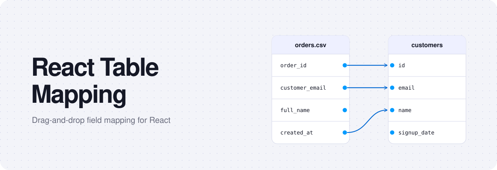

<div align="center">
  <a href="https://react-table-mapping.github.io/react-table-mapping/" title="React Table Mapping documentation">
    <picture>
      <source media="(prefers-color-scheme: dark)" srcset="https://raw.githubusercontent.com/react-table-mapping/react-table-mapping/main/.github/assets/banner-dark.svg" />
      
    </picture>
  </a>
  <p>
    <a href="https://www.npmjs.com/package/react-table-mapping"></a>
    <a href="https://bundlephobia.com/package/react-table-mapping"></a>
    <a href="https://github.com/react-table-mapping/react-table-mapping/blob/main/LICENSE"></a>
  </p>
</div>

## What is React Table Mapping?

A React component for mapping one list of fields onto another: a source table on the left, a target table on the right, and the lines you draw between them. Lines are drawn by dragging, by clicking one dot and then another, or with the keyboard alone.

```tsx
import { useState } from 'react';
import { TableMapping } from 'react-table-mapping';
import type { FieldItemInput, Mapping } from 'react-table-mapping';
import 'react-table-mapping/styles';

const field = (id: string, value: string) => ({
  id,
  key: id,
  name: { type: 'string' as const, columnKey: 'name', value },
});

const sources = [field('order_id', 'order_id'), field('customer_email', 'customer_email')] satisfies FieldItemInput[];
const targets = [field('id', 'id'), field('email', 'email')] satisfies FieldItemInput[];

export function FieldMapper() {
  const [mappings, setMappings] = useState<Mapping[]>([]);

  return (
    <TableMapping
      sourceColumns={[{ title: 'orders.csv', key: 'name' }]}
      targetColumns={[{ title: 'customers', key: 'name' }]}
      sources={sources}
      targets={targets}
      mappings={mappings}
      onMappingChange={({ mappings }) => setMappings(mappings)}
    />
  );
}
```

- **Drag, click or keyboard** — every way of drawing a line ends in the same `onMappingChange` report
- **Controlled or uncontrolled** — feed changes back as props, or pass initial values and read state through `ref`
- **Editable cells** — `string`, `input` and `select` fields, with before/after hooks for removing rows
- **Accessible** — one tab stop per region, named controls, and connections announced to screen readers
- **Headless** — the same behaviour as prop getters, for when you need your own markup

## Entry points

| Import                         | What it gives you                                                               |
| ------------------------------ | ------------------------------------------------------------------------------- |
| `react-table-mapping`          | `<TableMapping />`, its `ref` API and the public types                          |
| `react-table-mapping/styles`   | The stylesheet for `<TableMapping />`                                           |
| `react-table-mapping/headless` | `useMappingBoard`, prop getters and `MappingCanvas` for building your own board |
| `react-table-mapping/core`     | The framework-free store and line geometry the other two are built on           |

## Getting Started

```bash
npm install react-table-mapping @radix-ui/react-select @radix-ui/react-slot
```

Requires React 19 (`react` and `react-dom` `^19.0.0`) and Node.js 22 or later. Import the styles once, wherever the board is used:

```ts
import 'react-table-mapping/styles';
```

Read the full documentation at **[react-table-mapping.github.io/react-table-mapping](https://react-table-mapping.github.io/react-table-mapping/)**, or try the [Storybook demo](https://react-table-mapping.vercel.app/?path=/story/reacttablemapping--demo-bezier-lines).

[English](https://react-table-mapping.github.io/react-table-mapping/) | [한국어](https://react-table-mapping.github.io/react-table-mapping/ko/)

## Development

```bash
yarn            # install
yarn dev        # example app
yarn storybook  # stories on port 6006
yarn test       # unit and contract tests
yarn test:e2e   # Playwright, in Chromium, Firefox and WebKit
```

See the [changelog](https://github.com/react-table-mapping/react-table-mapping/blob/main/CHANGELOG.md) for what changed in each release.

## License

MIT © [donghyun-git](https://github.com/donghyun-git). See [LICENSE](https://github.com/react-table-mapping/react-table-mapping/blob/main/LICENSE) for details.
